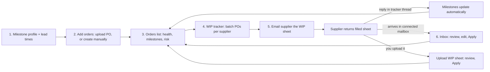

Production Order WIP tracks each purchase order (PO) through its production steps, from fabric order to ex-factory. SourceReady works out which orders are on time and which need you, and collects your suppliers' progress updates from spreadsheets and email so you don't have to retype them.

It's built for sourcing and merchandising teams who follow up with factories on many open orders at once.

<Frame caption="The Orders list shows every order's health and milestone progress.">
  
</Frame>

<Note>
  Production Order WIP is in early access and is turned on per workspace. If you don't see **Order** in the left sidebar, contact the SourceReady team to enable it.
</Note>

## Key terms

<table>
  <colgroup>
    <col width="150" />
    <col width="569" />
  </colgroup>
  <thead>
    <tr>
      <th>Term</th>
      <th>Meaning</th>
    </tr>
  </thead>
  <tbody>
    <tr>
      <td>**Order**</td>
      <td>One PO, or one style on a PO, that you're tracking. It has a supplier, dates, line items, and milestones</td>
    </tr>
    <tr>
      <td>**Milestone profile**</td>
      <td>The list of production steps an order moves through, such as PP sample, Cutting, and Ex-factory. Each step has a plan date and an actual date</td>
    </tr>
    <tr>
      <td>**Lead time set**</td>
      <td>Day offsets from a base date (usually the ex-factory date) that fill in each step's plan date for you</td>
    </tr>
    <tr>
      <td>**Risk tag**</td>
      <td>A rule that flags a problem on an order, such as a milestone more than a day overdue. Each tag is High, Medium, or Low severity</td>
    </tr>
    <tr>
      <td>**Health**</td>
      <td>The order's overall status, worked out from its risk tags: **At risk**, **Watch**, **On track**, or **Done**</td>
    </tr>
    <tr>
      <td>**WIP tracker**</td>
      <td>A batch of one supplier's orders that you follow up on together by email</td>
    </tr>
    <tr>
      <td>**WIP sheet**</td>
      <td>A spreadsheet of orders and milestone dates that the supplier fills in and sends back</td>
    </tr>
  </tbody>
</table>

## How it fits together

A filled-in WIP sheet can come back three ways. A sheet attached to a reply on a WIP tracker's email thread is applied automatically. A sheet you upload yourself, or one that arrives through the Inbox, is applied only after you click **Apply**.

## Run the whole flow in about 30 minutes

<Steps>
  <Step title="Set up a milestone profile and lead times">
    Go to **Settings → Order → Milestones**. Click **Add profile**, add one step for each production gate, and check **Default profile**. Then open **Lead times**, choose **Ex-factory date** as the **Base date**, and enter how many days before ex-factory each step should happen.

    See [Milestones](/milestones).
  </Step>
  <Step title="Check your risk tags">
    Go to **Settings → Order → Risk definition**. Every workspace starts with a High tag that flags any milestone more than a day overdue, so you can keep it and move on. Add your own tags later.

    See [Risk definition](/risk-definition). To add fields such as season or customer program, see [Order fields](/order-fields). If your POs or suppliers' sheets need reading hints, such as which column holds the PO number, save them in [Import instructions](/import-instructions).
  </Step>
  <Step title="Upload a buyer PO">
    Go to **Order → Orders** and click **Upload POs**. Pick your profile and lead times, add your PO files under **PO documents**, and click **Extract**. Check the extracted orders, then click **Save all**.

    If the supplier is already in your supplier list, pick it under **Select supplier**. WIP tracker emails go to that supplier's contacts.

    See [Upload POs](/upload-po). No PO file? [Create an order](/create-order) by hand instead.
  </Step>
  <Step title="Read the Orders list">
    Your new orders appear with their **Health** and a milestone tick bar. Hover a tick to see the step's dates, and open an order to see why it's at risk and to update a step.

    See [Orders](/orders) and [Order details](/order-details).
  </Step>
  <Step title="Create a WIP tracker">
    Select the new orders, click **Add to WIP tracker**, then **New WIP tracker with these POs**. A tracker holds one supplier's orders.

    See [WIP tracker](/wip-tracker#create-a-tracker).
  </Step>
  <Step title="Email the supplier the WIP sheet">
    In the tracker, click **Email supplier**. The WIP sheet for its orders is attached for you. Check the recipients and message, then click **Send now**. When the supplier replies on that thread with the filled-in sheet, the milestones update automatically.

    See [Email the supplier](/wip-tracker#email-the-supplier).
  </Step>
  <Step title="Apply a returned WIP sheet">
    If a supplier sends back a filled-in sheet some other way, such as WeChat or a shared drive, upload it yourself: click **Upload WIP sheet** on the Orders list, click **Extract**, check the proposed changes, and click **Apply**. Watch the orders' milestones and health change.

    See [Upload a WIP sheet](/upload-wip-sheet).
  </Step>
  <Step title="Connect your inbox (optional)">
    Under **Settings → Order → Inbox**, connect the Gmail or Outlook mailbox your suppliers write to. SourceReady reads their emails and attachments and turns them into updates you review and apply.

    See [Inbox](/inbox) and [Receive via inbox](/receive-via-inbox).
  </Step>
</Steps>

<Tip>
  Once you have orders, ask the AI agent about them in plain language, such as "Which orders are at risk this month?", or have it update milestones for you. See [Manage orders with the AI agent](/orders-ai-agent).
</Tip>

## Next

<Columns cols={2}>
  <Card title="Milestones" icon="list-check" href="/milestones">
    Set up your first milestone profile.
  </Card>

  <Card title="Upload POs" icon="file-arrow-up" href="/upload-po">
    Turn your buyer POs into tracked orders.
  </Card>
</Columns>
